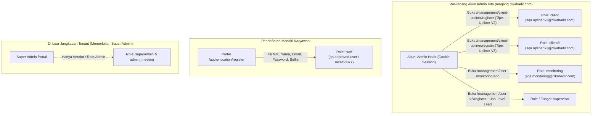

# Dokumentasi Role dan Manajemen Pengguna — Hadir (magang.dikahadir.com)

Dokumen ini memuat pemetaan komprehensif seluruh **peran pengguna (roles)** pada platform Hadir, **daftar akun yang dimiliki/berhasil dibuat**, serta **analisis batasan wewenang pembuatan akun secara normal (legitimate / tanpa celah/bug)**.

---

## 1. Daftar dan Klasifikasi Seluruh Role Sistem

Berdasarkan analisis arsitektur frontend Next.js (`_app-2ad6ec1cd5a42c22.js`) dan skema data pengguna Hadir, sistem mengoperasikan **8 Role Sistem Utama** dan **1 Peran Fungsional Khusus (Flag Role)**:

```javascript
const roles = {
  super: "superadmin",       // Super Admin
  admin: "admin",             // Administrator / HR Admin
  meeting: "admin_meeting",   // Admin Ruang Meeting
  spv: "supervisor",          // Supervisor / SPV
  staff: "staff",             // Staff / Karyawan Biasa
  client: "client",           // Upliner / Klien V2 (Data Validator 1)
  client3: "client3",         // Upliner / Klien V3 (Data Validator 2)
  monitoring: "monitoring"    // User Monitoring
};
```

### Tabel Rincian Hak Akses & Cakupan Role

| No | Kode `role_id` | Nama Role | Cakupan Wewenang & Menu Utama | Halaman Utama (Landing URL) |
|:--:|:---------------|:----------|:------------------------------|:----------------------------|
| 1 | **`superadmin`** | **Super Admin** | Tingkat akses root global multi-perusahaan. Mengelola registrasi perusahaan baru (`/superadmin/management/company`), manajemen semua akun user global (`/superadmin/management/user`), dan rekapitulasi laporan lintas instansi (`/superadmin/laporan/all`). | `/superadmin/dashboard` |
| 2 | **`admin`** | **Administrator (HR Admin)** | Mengelola seluruh operasional perusahaan/tenant: seluruh 17 modul Master Management (`/management/*`), seluruh modul Laporan (`/laporan/*`), approval absensi, dan pengaturan sistem. | `/dashboards/dashboard` |
| 3 | **`admin_meeting`** | **Admin Ruang Meeting** | Mengelola sarana dan prasarana rapat: daftar ruangan rapat (`/admin_meeting/ruang_meeting`) dan reservasi/booking meeting (`/admin_meeting/booking`). | `/admin_meeting/meeting_rooms` |
| 4 | **`supervisor`** | **Supervisor (SPV)** | Memantau kehadiran anggota tim di bawah divisinya; validasi dan persetujuan (approval) koreksi jam, izin keterlambatan, cuti, serta lembur anggota tim. | `/dashboards/dashboard` |
| 5 | **`staff`** | **Staff / Karyawan Biasa** | Melakukan absensi presensi harian (swafoto & GPS), melihat jadwal/kalender kerja, dan mengajukan permohonan izin, cuti, atau lembur secara mandiri. | Portal Web & Mobile Hadir |
| 6 | **`client`** | **Upliner / Klien V2** | Akun perwakilan mitra/klien; memantau daftar karyawan mitra (`/client/staff/lists`), melihat laporan kehadiran, dan bertindak sebagai **Data Validator 1** pada persetujuan cuti & lembur berjenjang. | `/client/all` |
| 7 | **`client3`** | **Upliner / Klien V3** | Versi lanjutan dari peran Klien; memegang hak verifikasi pada tingkatan kedua sebagai **Data Validator 2**. | `/client/all` |
| 8 | **`monitoring`** | **User Monitoring** | Akun pengawas/auditor *read-only*; memantau data kehadiran, koreksi, sakit, cuti, dan lembur secara real-time serta mengunduh berkas laporan tanpa hak modifikasi master data. | `/monitoring/semua` |
| 9 | **`isLeader`** *(Flag)* | **Team Leader** | Penugasan fungsional pada akun staf/karyawan untuk memimpin regu/shift. Memiliki menu khusus mengelola staf regu (`/leader/staff/lists`), rekapitulasi tim (`/leader/all`), persetujuan **Izin Off** (`/leader/izin-off`), dan ekspor laporan (`/leader/generate`). | `/leader/all` |

---

## 2. Daftar Role Beserta Akun yang Kita Miliki

Berikut adalah daftar inventaris akun nyata yang telah dikonfigurasi dan berhasil dibuat secara resmi pada sistem Hadir (`https://magang.dikahadir.com`):

| No | Role Sistem | Nama Pengguna | Email / Kredensial | Password / Akses | Status Akun | Jalur Pembuatan |
|:--:|:------------|:--------------|:-------------------|:-----------------|:-----------:|:----------------|
| 1 | **`admin`** | **Admin Hadir** | Sesi terautentikasi live | Cookie `hadir_web_magang` di `SessionHelper.java` | ✅ **Aktif (Live)** | Diberikan oleh platform tenant Hadir |
| 2 | **`client`** (Upliner V2) | **Upliner V2 SQA Test** | `sqa.upliner.v2@dikahadir.com` | `P@ssw0rdUpliner123!` | ✅ **Aktif (Live)** | Dibuat via UI resmi `/management/client-upliner/register` |
| 3 | **`client3`** (Upliner V3) | **Upliner V3 SQA Test** | `sqa.upliner.v3@dikahadir.com` | `P@ssw0rdUpliner123!` | ✅ **Aktif (Live)** | Dibuat via UI resmi `/management/client-upliner/register` |
| 4 | **`monitoring`** | **Auditor Monitoring SQA Test** | `sqa.monitoring@dikahadir.com` | `P@ssw0rdMonitoring123!` | ✅ **Aktif (Live)** | Dibuat via UI resmi `/management/user-monitoring/add` |
| 5 | **`staff`** (Approved) | **QA Approved User** | `qa.approved.user@dikahadir.com` | `P@ssw0rdMagang123` | ✅ **Aktif (Live)** | Registrasi mandiri + Approved Admin |
| 6 | **`staff`** (Pending) | **Raxaf Test User** | `raxaf58877@backyr.com` | `P@ssw0rdMagang123` | ⏳ **Pending Approval** | Registrasi mandiri di `/authentication/register` |
| 7 | **`supervisor`** | **Supervisor Tim QA** | Ditugaskan via Upliner 1 | Menyesuaikan akun staf terkait | ✅ **Fungsional** | Penugasan Job Level (`Lead / Manager`) & Upliner |

---

## 3. Daftar Role yang TIDAK BISA Kita Buat Akunnya

Sesuai prinsip keamanan **Role-Based Access Control (RBAC)** dan asas *Least Privilege*, terdapat role tertentu yang **tidak dapat dibuat oleh akun Administrator tenant/perusahaan kita secara normal** tanpa memanfaatkan celah/bug:

| No | Role yang Tidak Bisa Dibuat | Tingkat Otoritas | Alasan Mengapa Tidak Bisa Dibuat Secara Normal |
|:--:|:----------------------------|:-----------------|:-----------------------------------------------|
| 1 | **`superadmin`** | **Root Vendor Platform** | Role ini memegang kendali atas seluruh perusahaan (multi-tenant) di server Hadir. Sesuai arsitektur keamanan, akun `superadmin` hanya dapat dibuat oleh sesama Super Admin dari portal khusus `/superadmin/management/user` atau diinisialisasi melalui migrasi langsung ke basis data (*database seed*). Administrator perusahaan biasa sengaja diisolasi agar tidak dapat menaikkan hak istimewa (*privilege escalation*). |
| 2 | **`admin_meeting`** | **Add-on Khusus Fasilitas** | Role ini diperuntukkan khusus bagi pengelola fasilitas ruang rapat yang modulnya diaktifkan secara terpisah oleh pihak vendor/Super Admin. Pada antarmuka pendaftaran karyawan tenant, tidak tersedia opsi pemilihan peran `admin_meeting`. |
| 3 | **`admin` Baru** | **Tenant Administrator** | Akun Admin perusahaan pertama kali di-generate oleh Super Admin saat pendaftaran perusahaan baru di `/superadmin/management/company`. Administrator biasa dalam satu perusahaan tidak memiliki tombol di menu user staff untuk mencetak akun Admin baru sembarangan demi mencegah kompromi internal. |

---

## 4. Alur Kerja Pembuatan Akun yang Diizinkan (Normal Flow)



---

## 5. Ringkasan Kesimpulan

1. **Akun yang berhasil dibuat dan aktif:** Akun resmi untuk **`client`** (Upliner V2), **`client3`** (Upliner V3), dan **`monitoring`** (User Monitoring) telah berhasil didaftarkan langsung ke web live `https://magang.dikahadir.com` menggunakan alur resmi menu Management Admin.
2. **Akun yang sudah ada sebelumnya:** Akun **`admin`** aktif (sesi live) dan akun **`staff`** (peserta magang aktif & pending).
3. **Akun yang tidak bisa dibuat:** Role **`superadmin`** dan **`admin_meeting`** berada di level vendor/Super Admin platform dan dilindungi oleh kontrol hak akses sistem multi-tenant Hadir.
